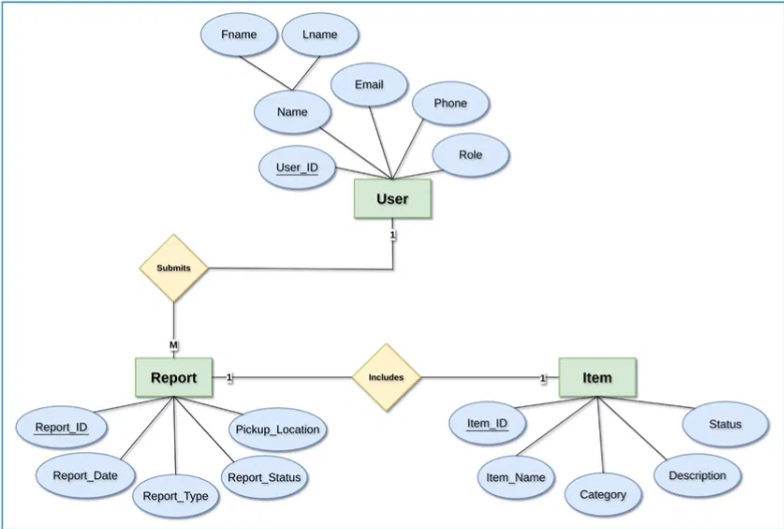

# Lost and Found Management System

A relational database system designed to manage lost and found items efficiently. It organizes user reports and item information in a structured schema.

## Features
- Three tables: User, Report, and Item
- Primary Keys and Foreign Keys (Report → User, Item → Report)
- One-to-one relationship between Report and Item (UNIQUE constraint on Item.Report_ID)
- Data integrity using NOT NULL, UNIQUE, ENUM, and CHECK constraints
- Sample data for users, reports, and items
- Queries for filtering, counting, grouping, JOIN, and subquery
- A view (Pending_Reports) to list pending reports

## ER Diagram

## Files
- `lost_and_found.sql`: creates the LostAndFound database and its tables with keys and constraints, inserts sample data, and includes the queries and the view.
- `ER_Diagram.png`: entity-relationship diagram of the database.

## How to Run
1. Open MySQL Workbench.
2. Open `lost_and_found.sql`.
3. Execute the script.

## Technologies
SQL, MySQL, Database Design, ERD

## Context
Course project at Umm Al-Qura University.
